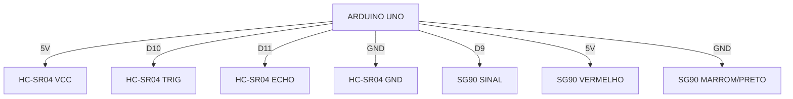

# STARK RADAR 180° — DIAGRAMA ELÉTRICO

## 1. Arduino Uno e HC-SR04

| HC-SR04 | Arduino Uno |
|---|---|
| VCC | 5V |
| TRIG | D10 |
| ECHO | D11 |
| GND | GND |

## 2. Arduino Uno e servo SG90

| SG90 | Arduino Uno |
|---|---|
| Fio laranja/amarelo (sinal) | D9 |
| Fio vermelho | 5V |
| Fio marrom/preto | GND |

## 3. Diagrama de conexões

## 4. Comunicação com o computador

O Arduino é conectado ao computador por USB.

O Processing recebe os dados pela comunicação serial a 9600 baud.

## 5. Atenção à alimentação

- Confira a polaridade antes de ligar.
- Não inverta os fios de alimentação.
- Se o servo apresentar instabilidade ou reiniciar o Arduino, pode ser necessária uma fonte externa regulada de 5V, com GND compartilhado.
- Não conecte uma fonte externa sem conferir a montagem e a orientação de um adulto.

## 6. Resumo dos pinos

| Pino Arduino | Função |
|---|---|
| D9 | Servo SG90 |
| D10 | TRIG |
| D11 | ECHO |
| 5V | Alimentação |
| GND | Terra comum |
